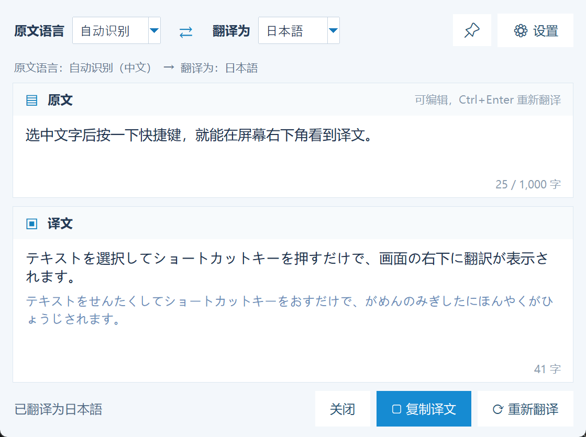
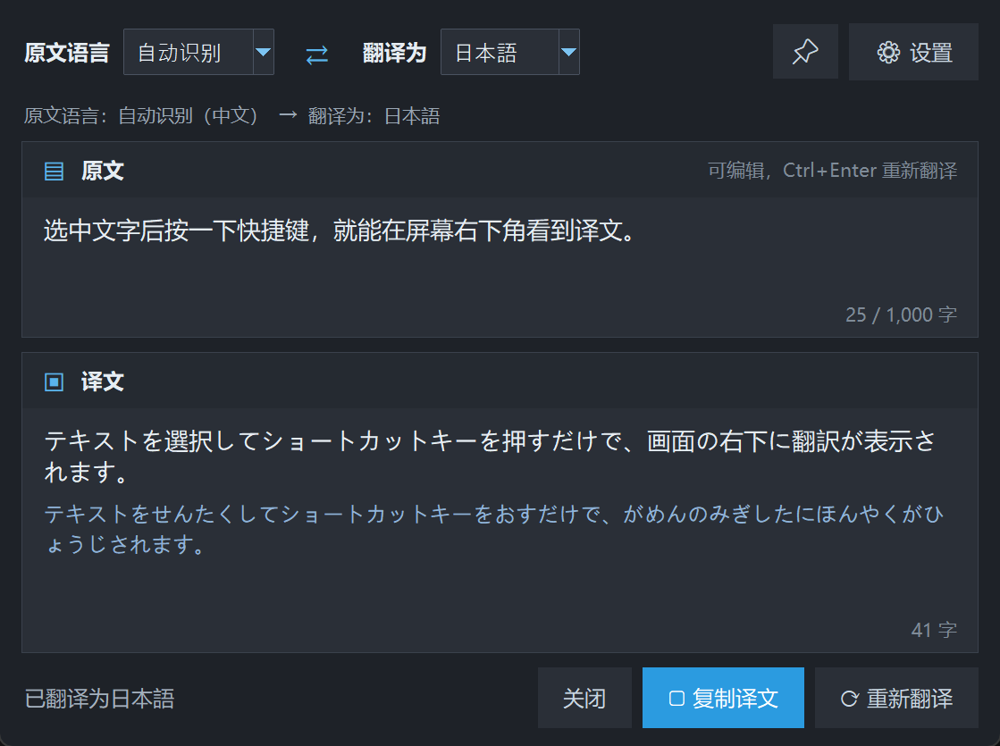
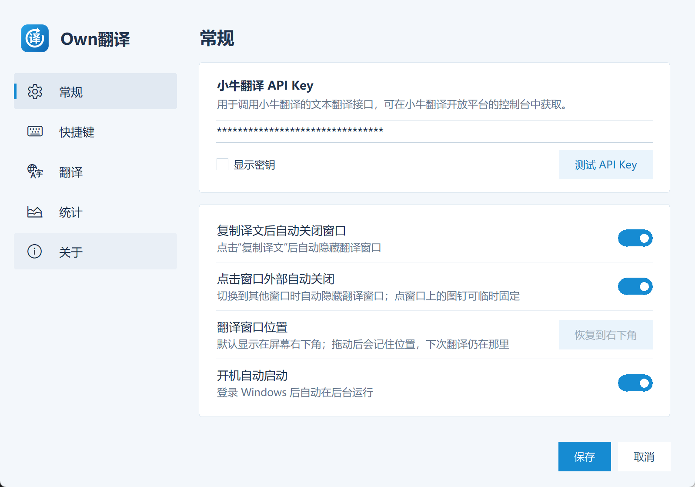

<p align="center"></p>

<h1 align="center">Own翻译</h1>

<p align="center">Windows 上的划词翻译工具：在任意软件中选中文字，按 <code>Ctrl+Alt+1</code>，译文就出现在屏幕右下角。<br>
支持中文 / 日本語 / English 互译，翻译服务由<a href="https://niutrans.com/">小牛翻译</a>提供。</p>

<p align="center">
  
  
</p>

## 功能

- **选中即译**：选中文字后按 `Ctrl+Alt+1`，程序自动复制选中内容并翻译，读取后会把剪贴板恢复成你原来复制的内容。
- **翻译剪贴板**：按 `Ctrl+Alt+2` 直接翻译剪贴板里已有的文字，适合无法自动复制的软件。
- **自动识别语言**：原文是中文时默认翻译成日文，其他语言默认翻译成中文；也可以手动选择原文语言和目标语言。
- **日文假名读音**：译文为日文时，在下方用小字显示整句的假名读音（类似谷歌翻译），可在设置中关闭。
- **交换语言**：点 `⇄` 把译文当作新的原文反向翻译；结果会缓存，来回切换不会重复请求 API。
- **原文可编辑**：直接修改原文，按 `Ctrl+Enter` 重新翻译；原文和译文右下角显示字数。
- **窗口位置可记忆**：默认在屏幕右下角，拖到哪里，下次就出现在哪里；切换到其他窗口时自动隐藏，点图钉可固定。
- **省积分**：相同内容命中缓存不再请求 API；可设置单次翻译字数上限（默认 1000 字）。
- **出错有说明**：API Key 无效、额度用完、网络问题等会显示易懂的原因；超时以外的失败自动重试一次。
- **深色模式**：跟随 Windows 的深色 / 浅色设置；支持高 DPI 屏幕和多显示器。
- **托盘常驻**：左键单击托盘图标重新打开上一次的翻译，鼠标悬停显示当前快捷键；可设置开机自动启动。

<p align="center"></p>

## 下载与使用

1. 到 [Releases](../../releases/latest) 下载 `OwnTranslation-vX.Y.Z-win64.zip`，解压后得到 `Own翻译.exe`。不需要安装，也不需要 Python。
2. 双击运行。首次运行会打开设置页，填入你的小牛翻译 API Key（见下文），可以点“测试 API Key”确认能用。
3. 在任意软件中选中文字，按 `Ctrl+Alt+1`。

系统要求：64 位 Windows 10 / 11。

### 首次运行的提示

- **“Windows 已保护你的电脑”**：程序没有数字签名，点“更多信息” → “仍要运行”即可，只有第一次会出现。
- **杀毒软件误报**：程序需要监听全局快捷键并模拟 `Ctrl+C`，部分杀毒软件会因此报毒，请手动加入信任。可以对照 Release 页面给出的 SHA256 校验值确认文件没有被修改。

### 获取小牛翻译 API Key

在 [小牛翻译开放平台](https://niutrans.com/) 注册并登录，在控制台中找到“API Key”。免费额度和计费方式以官方说明为准；本工具的“设置 → 统计”会显示本机今日已翻译的字数。

## 快捷键

| 操作 | 默认快捷键 |
|---|---|
| 翻译选中文字 | `Ctrl+Alt+1` |
| 翻译剪贴板 | `Ctrl+Alt+2` |
| 关闭翻译窗口 | `Esc` |
| 修改原文后重新翻译 | `Ctrl+Enter` |

两个全局快捷键都可以在“设置 → 快捷键”中修改：点击按键框，直接按下新的组合键即可（需要包含 Ctrl / Alt / Shift / Win 中的至少一个）。

## 数据与隐私

- 选中的文字会发送到小牛翻译的 API 进行翻译，除此之外程序不联网。
- 配置保存在 `%APPDATA%\NiuTransQuick\config.json`，**API Key 以明文保存在这个文件里**，请不要把它分享给别人。
- 日志保存在同目录的 `log.txt`，只记录警告和错误，不包含 API Key 和翻译内容。遇到问题时可以附上这个文件提 Issue。
- 翻译缓存只保存在内存中，退出程序即清空。

## 已知限制

- 在“以管理员身份运行”的软件中，自动复制可能无效。这时可以先手动 `Ctrl+C`，再按 `Ctrl+Alt+2`。
- 带 Win 键的组合（如 `Win+1`）可能被 Windows 优先拦截，建议使用 Ctrl / Alt / Shift 组合。
- 假名读音由离线词典生成，个别词可能读错（例如句首的“今日は”）。
- 小牛翻译文本接口单次最多 5000 字，因此字数上限最多设为 5000。
- 仅支持 Windows。

## 从源码运行与打包

需要 64 位 Python 3.10 或更高版本。

```powershell
python -m pip install -r requirements.txt
python app.py          # 直接运行源码
.\build.ps1            # 打包，生成 dist\Own翻译.exe
```

如果 PowerShell 提示禁止运行脚本，可以先执行 `Set-ExecutionPolicy -Scope CurrentUser RemoteSigned`。打包前请先退出正在运行的 `Own翻译.exe`。

代码结构和实现说明见 [CLAUDE.md](CLAUDE.md)。

## 许可

[MIT](LICENSE)
