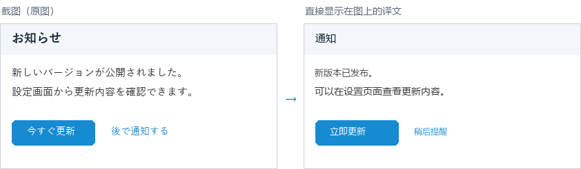

<p align="center"></p>

<h1 align="center">Own翻译</h1>

<p align="center">Windows 上的划词翻译工具：在任意软件中选中文字，按 <code>Ctrl+Alt+1</code>，译文就出现在屏幕右下角；图片里的文字可以按 <code>Ctrl+Alt+3</code> 截图翻译。<br>
支持中文 / 日本語 / English 互译，翻译服务由<a href="https://niutrans.com/">小牛翻译</a>提供。</p>

<p align="center">
  
  
</p>

## 功能

- **选中即译**：选中文字后按 `Ctrl+Alt+1`，程序自动复制选中内容并翻译，读取后会把剪贴板恢复成你原来复制的内容。
- **替换原文**：选中即译的结果可以点“替换原文”直接贴回原来的位置，替换掉选中的文字；如果原窗口已经丢失了选中状态（如谷歌翻译的输入框只选了一部分），译文会加在原文后面。
- **翻译剪贴板**：按 `Ctrl+Alt+2` 直接翻译剪贴板里已有的文字，适合无法自动复制的软件。
- **截图翻译**：按 `Ctrl+Alt+3` 框选屏幕上的任意区域，识别其中的文字并翻译，像谷歌翻译那样**把译文直接画在原位置上**；可用 Windows 自带的离线识别，也可以接入识别更准的百度 OCR。详见下文 [截图翻译](#截图翻译)。
- **自动识别语言**：原文是中文时默认翻译成日文，其他语言默认翻译成中文；也可以手动选择原文语言和目标语言，选成同一种语言时两边自动互换。
- **日文假名读音**：译文为日文时，在下方用小字显示整句的假名读音（类似谷歌翻译），可在设置中关闭。
- **交换语言**：点 `⇄` 把译文当作新的原文反向翻译；结果会缓存，来回切换不会重复请求 API。
- **原文可编辑**：直接修改原文，按 `Ctrl+Enter` 或点“重新翻译”重新请求（不使用缓存，可替换掉不满意的译文）；原文和译文右下角显示字数。
- **窗口位置可记忆**：默认在屏幕右下角，拖到哪里，下次就出现在哪里；切换到其他窗口时自动隐藏，点图钉可固定。
- **省积分**：相同内容命中缓存不再请求 API；可设置单次翻译字数上限（默认 1000 字）。
- **出错有说明**：API Key 无效、额度用完、网络问题等会显示易懂的原因；超时以外的失败自动重试一次。
- **深色模式**：跟随 Windows 的深色 / 浅色设置；支持高 DPI 屏幕和多显示器。
- **托盘常驻**：左键单击托盘图标重新打开上一次的翻译，鼠标悬停显示当前快捷键；可设置开机自动启动。

<p align="center"></p>

## 下载与使用

1. 到 [Releases](../../releases/latest) 下载 `OwnTranslation-vX.Y.Z-win64.zip`，解压后得到 `Own翻译.exe`。不需要安装，也不需要 Python。
2. 双击运行。首次运行会打开设置页，填入你的小牛翻译 API Key（见下文），可以点“测试 API Key”确认能用。
3. 在任意软件中选中文字，按 `Ctrl+Alt+1`。

系统要求：64 位 Windows 10 / 11。

### 首次运行的提示

- **“Windows 已保护你的电脑”**：程序没有数字签名，点“更多信息” → “仍要运行”即可，只有第一次会出现。
- **杀毒软件误报**：程序需要注册全局快捷键并模拟 `Ctrl+C`，部分杀毒软件可能因此报毒，请手动加入信任。可以对照 Release 页面给出的 SHA256 校验值确认文件没有被修改。

### 获取小牛翻译 API Key

在 [小牛翻译开放平台](https://niutrans.com/) 注册并登录，在控制台中找到“API Key”。免费额度和计费方式以官方说明为准；本工具的“设置 → 统计”会显示本机今日已翻译的字数。

## 截图翻译

图片、扫描件、软件界面里没法选中的文字，可以截图翻译。

<p align="center"></p>

### 使用方法

1. 按 `Ctrl+Alt+3`（或托盘菜单 → “截图翻译”），屏幕变暗。
2. 按住鼠标拖出要翻译的区域，松开后自动识别并翻译。按 `Esc` 或右键取消。
3. 译文直接盖在原来的位置上，下方的工具栏可以：
   - **原图 / 译图**：切换对照（也可以直接点图片）；
   - **复制译文** / **复制图片**：复制文字，或复制翻译后的整张图；
   - **在窗口中查看**：在翻译窗口里查看和修改原文、换目标语言，不会重复扣字数；
   - **✕** 或 `Esc`：关闭。

在“设置 → 截图识别”中关掉“截图翻译直接显示在图上”，识别结果就改为在翻译窗口里显示。

### 文字识别（OCR）引擎

| | Windows 自带 OCR（默认） | 百度 OCR（可选） |
|---|---|---|
| 准确度 | 一般，小字容易认错（如“语”认成“浯”） | 高，中文、日文、英文、中英混排都很准 |
| 费用 | 免费、离线 | 需要百度智能云账号，有每月免费额度 |
| 隐私 | 截图只在本机识别 | 截图会上传到百度识别 |
| 设置 | 无需设置 | 在“设置 → 截图识别”填写 API Key 和 Secret Key |

使用 Windows OCR 时，程序会同时用中文和日文识别，保留更可信的结果。中文版 Windows 一般自带中文识别，日文版自带日文识别；缺少时可在 Windows 的“设置 → 时间和语言 → 语言和区域”中添加对应语言，并安装“光学字符识别”。

### 使用百度 OCR

1. 登录 [百度智能云](https://cloud.baidu.com/)，进入 [文字识别控制台](https://console.bce.baidu.com/ai/#/ai/ocr/overview/index)。
2. 领取“通用文字识别”的免费资源（各接口的免费次数以控制台显示为准）。
3. 创建一个应用，在应用列表里复制它的 **API Key** 和 **Secret Key**。
4. 填到 Own翻译 的“设置 → 截图识别”，点“测试 OCR Key”，会显示四个接口各自能不能用，然后保存。

百度的通用文字识别有四个接口，每个都有自己的免费额度，程序会按下面的顺序使用，一个接口的额度用完就自动换下一个（当天不再尝试用完的接口）：

| 显示方式 | 依次使用 |
|---|---|
| 译文直接显示在图上（需要文字位置） | 高精度含位置版 → 标准含位置版 |
| 在翻译窗口中显示（只需要文字） | 高精度版 → 高精度含位置版 → 标准版 → 标准含位置版 |

百度都用不了时（额度用完、密钥错误、断网等），会自动改用 Windows OCR，并提示原因。

截图翻译识别出的文字同样用小牛翻译来翻译，会计入小牛的字数；OCR 本身不消耗小牛的额度。

## 快捷键

| 操作 | 默认快捷键 |
|---|---|
| 翻译选中文字 | `Ctrl+Alt+1` |
| 翻译剪贴板 | `Ctrl+Alt+2` |
| 截图翻译 | `Ctrl+Alt+3` |
| 关闭翻译窗口 | `Esc` |
| 修改原文后重新翻译 | `Ctrl+Enter` |

三个全局快捷键都可以在“设置 → 快捷键”中修改：点击按键框，直接按下新的组合键即可（需要包含 Ctrl / Alt / Shift / Win 中的至少一个）。如果组合键已被其他程序占用，设置页会直接提示。

## 数据与隐私

- 选中的文字会发送到小牛翻译的 API 进行翻译，除此之外程序不联网。截图默认只在本机内存中识别，不会上传或保存；填写了百度 OCR 的密钥后，截图会发送到百度智能云进行识别。
- 配置保存在 `%APPDATA%\NiuTransQuick\config.json`，**API Key 以明文保存在这个文件里**，请不要把它分享给别人。
- 日志保存在同目录的 `log.txt`，只记录警告和错误，不包含 API Key 和翻译内容。遇到问题时可以附上这个文件提 Issue。
- 翻译缓存只保存在内存中，退出程序即清空。

## 已知限制

- 在“以管理员身份运行”的软件中，自动复制可能无效。这时可以先手动 `Ctrl+C`，再按 `Ctrl+Alt+2`。
- 带 Win 键的组合（如 `Win+1`）可能被 Windows 优先拦截，建议使用 Ctrl / Alt / Shift 组合。
- 截图翻译：多栏、竖排、很小或艺术字体的文字可能识别不准，识别后可以在翻译窗口的原文框里修改再翻译；截图时只覆盖鼠标所在的显示器。
- 假名读音由离线词典生成，个别词可能读错（例如句首的“今日は”）。
- 小牛翻译文本接口单次最多 5000 字，因此字数上限最多设为 5000。
- 仅支持 Windows。

## 从源码运行与打包

需要 64 位 Python 3.10 或更高版本。

```powershell
python -m pip install -r requirements.txt
python app.py          # 直接运行源码
.\build.ps1            # 打包，生成 dist\Own翻译.exe
```

如果 PowerShell 提示禁止运行脚本，可以先执行 `Set-ExecutionPolicy -Scope CurrentUser RemoteSigned`。打包前请先退出正在运行的 `Own翻译.exe`。

代码结构和实现说明见 [CLAUDE.md](CLAUDE.md)。

## 许可

[MIT](LICENSE)
